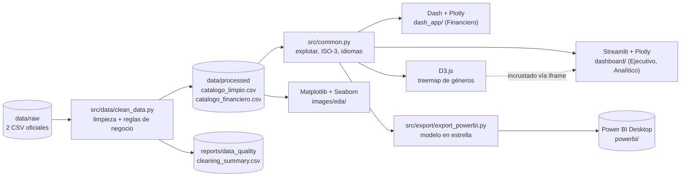

# EA2 · Arquitectura de la solución

## Visión general

## Capas

| Capa | Archivos | Responsabilidad |
|---|---|---|
| Datos crudos | `data/raw/` | Extracto oficial. **No se modifica** (supuesto del caso). |
| Preparación | `src/data/clean_data.py` | Limpieza, reglas de negocio, columnas derivadas. Toda decisión queda en `cleaning_summary.csv`. |
| Lógica compartida | `src/common.py`, `dashboard/utils.py` | Una sola definición de cada helper e indicador (resuelve el problema 1 del caso: «múltiples versiones de un mismo indicador»). |
| Presentación | `dashboard/`, `dash_app/`, `d3/`, `powerbi/` | Cada herramienta consume el **mismo** dato procesado. |
| Documentación | `docs/`, `reports/` | Justificación de diseño, Gitflow, guion. |

## Rol de cada herramienta

| Herramienta | Dónde se usa | Por qué esta herramienta ahí |
|---|---|---|
| **Streamlit** | Dashboards Ejecutivo y Analítico (multipágina) | Filtros reactivos, KPIs y navegación con poco código; es el producto principal. |
| **Plotly** | Gráficos de ambos dashboards | Interactividad (hover, zoom) y mapas coropléticos. |
| **Dash** | `dash_app/app.py` (financiero) | Alternativa con callbacks explícitos; muestra el mismo análisis financiero en otro framework. |
| **D3.js** | Treemap de géneros | Control total del layout; Python entrega JSON y D3 dibuja. Se incrusta en Streamlit y existe como HTML autónomo. |
| **Matplotlib + Seaborn** | `src/analysis/` → `images/eda/` | Gráficos estáticos para informe y presentación (heatmap de correlaciones, distribuciones). |
| **Power BI** | `powerbi/` | Versión corporativa autoservicio sobre el modelo en estrella exportado. |

## Modelo de datos (Power BI)

`fact_catalogo (uid)` ─1:N─ `bridge_genero`, `bridge_pais`, `bridge_director`, `bridge_actor`
`fact_catalogo (uid)` ─1:1─ `fact_financiero` (solo películas con presupuesto e ingresos)
`dim_calendario (anio)` ─1:N─ `fact_catalogo (anio_estreno)`

La clave es `uid` (= `M`/`T` + `show_id`) porque **`show_id` se repite entre películas y series (397 casos)**.

## Decisiones de datos que afectan a los indicadores

| Decisión | Motivo |
|---|---|
| `uid` como clave | `show_id` no es único en el catálogo unificado. |
| `calificacion` = `vote_average` solo con ≥ 10 votos | Con pocos votos la nota es ruido: 947 de los 1.073 títulos con nota ≥ 9 tienen menos de 5 votos. Se conserva `vote_average` original. |
| `popularity_pct` (percentil dentro del tipo) | La popularidad de series y películas está en escalas distintas (promedio ≈65 vs ≈20). Permite comparar géneros/países sin sesgo por mezcla de tipos (regla de negocio 2). |
| `presupuesto_realista` (budget ≥ USD 10.000) | 15 películas declaran presupuestos de USD 1 a 9.999 y producen ROI de millones de veces. |
| Mínimos de títulos | Promedios por país/género solo se muestran con volumen suficiente (valores ajustables en la barra lateral). |
